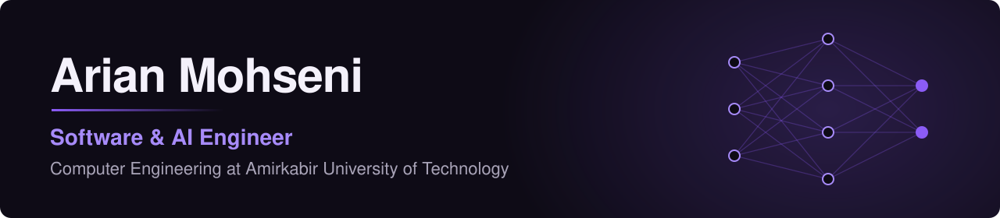
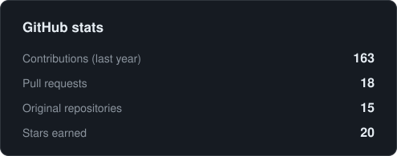
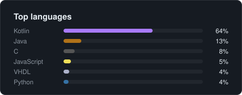

## Currently:

- 🎓 Computer Engineering BSc student at Amirkabir University of Technology
- 🧠 Working on machine learning with TensorFlow and scikit-learn
- 📱 Building Android apps with Kotlin and Jetpack Compose
- 💼 Open to full-time roles, research collaborations and graduate opportunities

## Tech Stack:

## Activity:

 

## Contact:

[LinkedIn](https://www.linkedin.com/in/arian-mohseni-348a6b24b) · [Email](mailto:arianmohseni1382@gmail.com) · [Stack Overflow](https://stackoverflow.com/users/20221248/arianmohseni) · [Instagram](https://www.instagram.com/arian_mhb)
